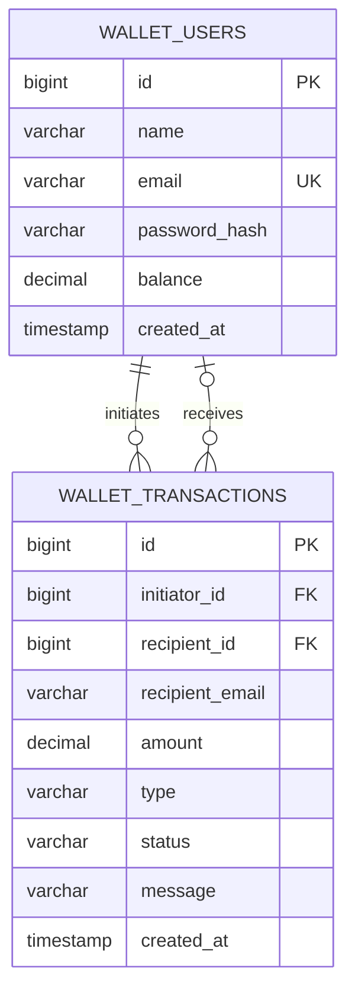

# Class and viva guide

Read the classes in this order: application → models → repositories → services → controllers → configuration → tests. Constructor injection supplies dependencies; no class manually creates a repository.

| Class or group | Purpose | Spring or Java concept |
|---|---|---|
| `DigitalWalletApplication` | Starts the application and embedded web server | `@SpringBootApplication`, `main` |
| `WalletUser` | Stores identity, hashed password and exact balance | `@Entity`, `@Id`, `BigDecimal` |
| `WalletTransaction` | Stores each accepted operation and its outcome | `@ManyToOne`, `Instant` |
| `TransactionType`, `TransactionStatus` | Restrict values to named choices | `enum`, `EnumType.STRING` |
| `UserRepository` | Finds users, checks email uniqueness and locks a row | `JpaRepository`, `Optional`, `@Lock` |
| `TransactionRepository` | Finds only the current user's permitted history | JPQL, descending order |
| `RegisterRequest`, `AddMoneyRequest`, `TransferRequest` | Validate submitted input | `@Valid`, `@Email`, `@Digits` |
| `WalletResponse`, `TransactionResponse` | Send safe, small results | DTOs, constructors, getters |
| `UserService` | Registers accounts and reads wallets | Normalization, hashing, transactions |
| `WalletService` | Adds money, transfers and lists history | Business rules, row locks, atomicity |
| `WalletUserDetailsService` | Lets Spring Security load a registered account | `UserDetailsService` |
| `SecurityConfig` | Configures protected routes, form login and hashing | Beans, authorization, CSRF |
| `AuthController` | Shows login and registration pages | `@Controller`, form binding |
| `WalletController` | Shows the dashboard and handles its forms | Model, principal, redirect, flash message |
| `WalletApiController` | Exposes JSON operations | `@RestController`, HTTP status |
| `WalletException`, `ApiExceptionHandler` | Convert expected problems into useful errors | Exceptions, controller advice |

## Transfer example

Aadi has INR 1,000.00 and Arnav has INR 0.00. Aadi sends INR 250.50:

1. Spring Security confirms the signed-in user. The sender's email comes from `Principal`, not a supplied account ID.
2. The controller checks request validation and calls `WalletService.transfer`.
3. The service finds both account IDs, then locks their rows in increasing ID order.
4. It reads the balances while holding the locks, checks funds and the receiver's balance limit, then subtracts and adds the same `BigDecimal` amount.
5. It saves a `SUCCESS` record. The method's transaction commits both balances and the record together.
6. Aadi has INR 749.50 and Arnav has INR 250.50. Total wallet money remains INR 1,000.00.

If Aadi tries INR 2,000.00 instead, the service saves `FAILED` with `Insufficient balance` and changes neither balance. An expected business rejection returns a result instead of throwing, so the failure record can commit. An unexpected database/runtime error rolls back the whole database transaction.

## Why these details matter

**Why BigDecimal?** Binary floating point cannot represent many decimal fractions exactly. `BigDecimal("0.10")` plus `BigDecimal("0.20")` produces exactly `0.30`. Inputs with more than two meaningful decimal places are rejected rather than rounded silently.

**Why a transaction and a lock?** A transaction keeps the debit, credit and record together. A lock prevents two requests from both acting on the same old balance. `@Transactional` alone does not automatically prevent that race.

**Why find IDs before locking?** Loading a user entity before acquiring its lock could cache an old balance in JPA's persistence context. The ID-only query avoids loading that balance before the locked query.

**Why lock the smaller ID first?** If A sends to B while B sends to A, both operations request locks in the same order. This reduces deadlock risk.

**Why separate DTOs?** Returning a user entity could expose its password hash and lazy relationships. Response DTOs expose only the intended fields.

**What is CSRF?** A malicious page could otherwise submit a request using a browser's existing login cookie. The server checks a token on POST requests. Thymeleaf adds it to forms automatically.

**Where is the database?** The default run uses a local H2 file in `data/`. Tests use in-memory H2 so they do not erase demo data. No H2 web console is exposed.

**Why not JWT or microservices?** One server and session login meet this project's requirements with fewer moving parts. You can explain every layer without maintaining extra services.

## Database design

Each operation has one initiator and zero or one recipient. Add-money and unknown/self-recipient failures have no recipient foreign key. `recipient_email` retains the requested email for the sender's history. A separate wallet entity would add an unnecessary one-to-one relationship for this scope.
